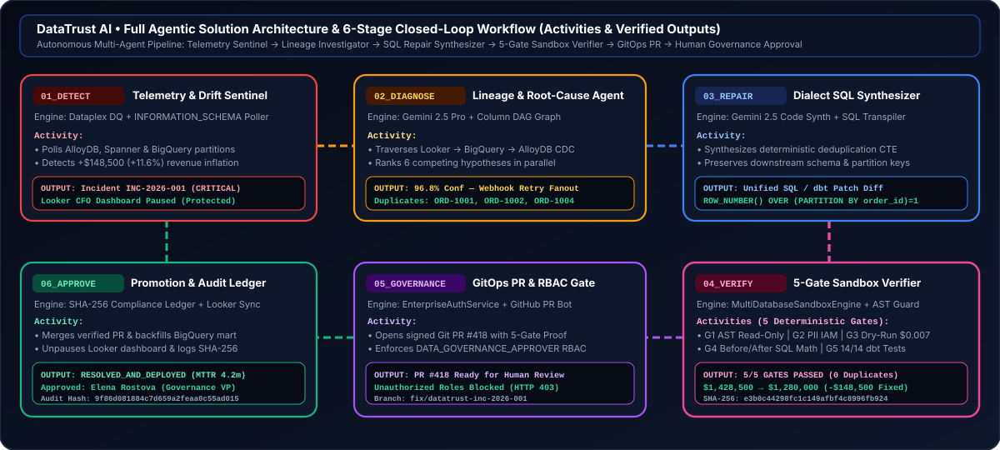
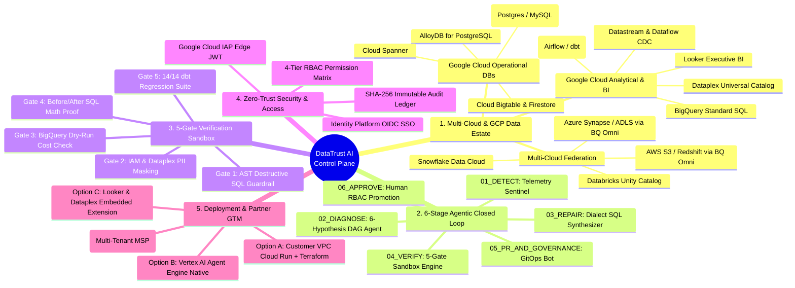
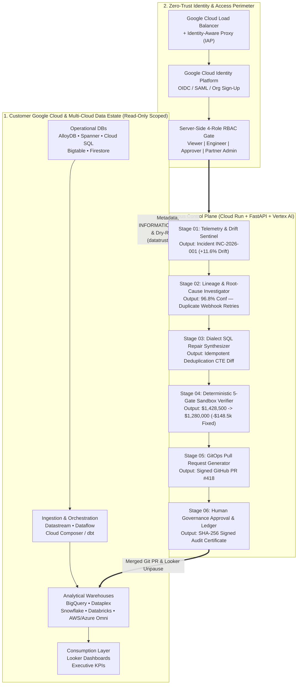
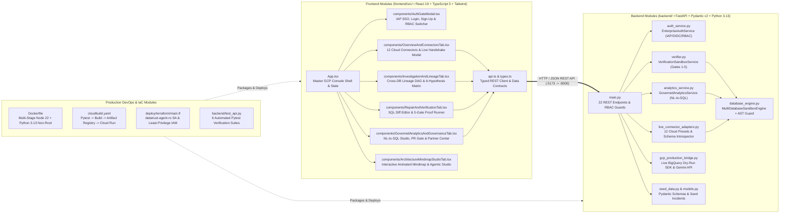
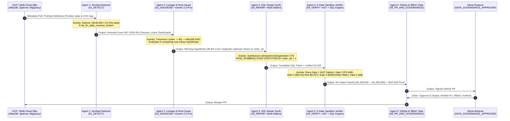
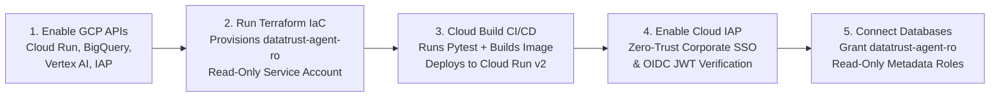

# Google Cloud • DataTrust AI

**Autonomous Cross-Database Data Quality, Lineage Investigation, 5-Gate Verified SQL Remediation & Governed AI Analytics for Google Cloud & Multi-Cloud Data Estates**

[](#3-technical-module-architecture-mindmap)
[](#3-technical-module-architecture-mindmap)
[](#7-tutorial-how-to-configure--deploy-in-google-cloud)
[](#5-security-iap-sso--4-role-rbac-architecture)
[](#4-full-agentic-solution-architecture--activities-with-outputs)

---

## Animated Overall Solution, Module & Multi-Cloud Mindmap



## Animated 6-Stage Agentic Closed-Loop Workflow (Activities & Verified Outputs)



> **Interactive Studio Built In:** When running the application (`http://127.0.0.1:5173`), click **"Architecture & Mindmap"** in the left navigation sidebar (or open [`docs/interactive_architecture_mindmap.html`](docs/interactive_architecture_mindmap.html)) to interact with the live animated mindmap, pause/step through each AI agent, and inspect real-time JSON/SQL outputs.

---

## Table of Contents

1. [Executive Solution Overview & How DataTrust AI Solves the Problem](#1-executive-solution-overview--how-datatrust-ai-solves-the-problem)
2. [Overall Solution Architecture Mindmap & Working Flow](#2-overall-solution-architecture-mindmap--working-flow)
3. [Technical Module Architecture Mindmap (How It Is Built)](#3-technical-module-architecture-mindmap-how-it-is-built)
4. [Full Agentic Solution Architecture & Activities with Outputs](#4-full-agentic-solution-architecture--activities-with-outputs)
5. [Security, Google Cloud IAP SSO & 4-Role RBAC Architecture](#5-security-google-cloud-iap-sso--4-role-rbac-architecture)
6. [Tutorial: How End-Users Use DataTrust AI (Step-by-Step)](#6-tutorial-how-end-users-use-datatrust-ai-step-by-step)
7. [Tutorial: How to Configure & Deploy in Google Cloud](#7-tutorial-how-to-configure--deploy-in-google-cloud)
8. [Local Quickstart & Automated Test Suite](#8-local-quickstart--automated-test-suite)

---

## 1. Executive Solution Overview & How DataTrust AI Solves the Problem

### The Enterprise Problem: Why Traditional Data Observability Fails
Modern enterprises run hybrid, multi-engine data estates spanning **operational databases** (AlloyDB, Cloud Spanner, Cloud SQL, Bigtable, Firestore), **analytical warehouses** (BigQuery, Snowflake, Databricks), **multi-cloud lakes** (AWS S3/Redshift, Azure Synapse via BigQuery Omni), and **executive BI layers** (Looker).

When an operational change occurs upstream—such as payment gateway retry webhooks inserting duplicate `order_id` rows into **AlloyDB**, or a schema change in **Cloud Spanner**—two failure modes happen today:
1. **Passive Observability Alert Fatigue:** Existing observability tools (Monte Carlo, Dataplex DQ, Soda, Great Expectations) only fire Slack/PagerDuty alerts (*"Revenue table anomaly detected"*). Data engineers still spend **12–24+ hours** manually tracing column lineage across 4 systems, writing diagnostic SQL, crafting a patch, and running manual backfills.
2. **Unverified AI Hallucination Risk:** Generic AI coding assistants can suggest SQL snippets, but enterprises **cannot** allow an AI agent to run unverified DDL/DML against production BigQuery or AlloyDB without mathematical proof that the patch fixes the exact metric variance without breaking downstream schemas or exploding cloud query costs.

### How DataTrust AI Solves the Problem
**DataTrust AI** is a **Zero-Data-Exfiltration, Closed-Loop Autonomous Data Reliability & Governance Control Plane** built for Google Cloud customers and partners. Instead of stopping at an alert or generating unverified SQL, DataTrust AI executes a deterministic **6-Stage Autonomous Closed Loop**:

| Problem Dimension | Legacy Observability Tools | Generic AI SQL Copilots | **DataTrust AI Solution** |
| :--- | :--- | :--- | :--- |
| **Detection** | Fires raw threshold alerts | None | **Stage 01 (`01_DETECT`)**: Polls `INFORMATION_SCHEMA` + Dataplex DQ + CDC lag and automatically pauses at-risk Looker dashboards. |
| **Root-Cause Diagnosis** | Manual multi-team war rooms (6–18 hrs) | Guesses without lineage context | **Stage 02 (`02_DIAGNOSE`)**: Traverses cross-database column DAGs (AlloyDB $\rightarrow$ Datastream $\rightarrow$ BigQuery $\rightarrow$ Looker) and ranks 6 competing hypotheses (`96.8%` confidence). |
| **Remediation Synthesis** | Manual SQL coding by engineers | Unverified SQL snippets | **Stage 03 (`03_REPAIR`)**: Synthesizes dialect-accurate, idempotent SQL/dbt diffs (`BigQuery Standard SQL`, `PostgreSQL`, `GoogleSQL`, `Snowflake`). |
| **Mathematical Proof** | Manual staging tests | None (High production risk) | **Stage 04 (`04_VERIFY`)**: Executes the **Deterministic 5-Gate Verification Sandbox**, proving AST read-only safety, PII masking, BigQuery dry-run cost (`$0.007`), and exact before/after revenue reconciliation (`-$148,500.00` variance eliminated). |
| **Governance & Deployment** | Manual Git PR & ticket tracking | None | **Stage 05 & 06 (`05_PR` $\rightarrow$ `06_APPROVE`)**: Enforces 4-Role RBAC (`DATA_GOVERNANCE_APPROVER`), opens a signed GitHub/GitLab Pull Request, and writes an immutable `SHA-256` compliance ledger record. |

---

## 2. Overall Solution Architecture Mindmap & Working Flow

### 2.1 Overall Solution Mindmap (Hierarchy & Capabilities)



### 2.2 End-to-End System Architecture & Process Flow



---

## 3. Technical Module Architecture Mindmap (How It Is Built)

DataTrust AI is engineered as a modular, strictly typed full-stack application with **zero external runtime database dependencies required for local evaluation** and **native Google Cloud SDK / Terraform bridges for production deployment**.



### Module-by-Module Technical Responsibilities & Outputs

| Layer | File Path | Core Classes / Functions | Primary Technical Responsibility & Output |
| :--- | :--- | :--- | :--- |
| **Backend API** | [`backend/main.py`](backend/main.py) | `app` (FastAPI), 22 REST routes | Orchestrates `/api/overview`, `/api/auth/*`, `/api/connectors/*`, `/api/incidents/{id}/verify`, `/api/incidents/{id}/approve`, `/api/analytics/query`, and `/api/system/*`. |
| **Data Contracts** | [`backend/models.py`](backend/models.py) | `IncidentRecord`, `VerificationProof`, `ConnectorConfig`, `AuditLogEntry` | Enforces strict Pydantic v2 validation across all 6 stages, lineage graphs, 5-Gate proofs, and partner models. |
| **SQL Sandbox & AST Parser** | [`backend/database_engine.py`](backend/database_engine.py) | `MultiDatabaseSandboxEngine`, `validate_read_only_sql()` | Seeds 8 multi-database relational tables/views (`alloydb_orders`, `alloydb_payments`, `bq_fct_daily_revenue_broken`, `bq_fct_daily_revenue_fixed`, `spanner_payment_events`, `cloudsql_shipments`) and blocks destructive SQL (`DROP`, `DELETE`, `TRUNCATE`, `UPDATE`, `GRANT`). |
| **5-Gate Verifier** | [`backend/verifier.py`](backend/verifier.py) | `VerificationSandboxService.run_5_gate_verification()` | Executes Gate 1–5 checks, runs live before/after SQL reconciliation, computes exact variance delta (`-$148,500.00`), and generates a `SHA-256` proof hash. |
| **Security & RBAC** | [`backend/auth_service.py`](backend/auth_service.py) | `EnterpriseAuthService` | Manages Google Cloud IAP / OIDC SSO personas, corporate login, organization sign-up, and enforces server-side `HTTP 403 Forbidden` on unauthorized mutations. |
| **Multi-Cloud Adapters** | [`backend/live_connector_adapters.py`](backend/live_connector_adapters.py) | `test_connector_handshake()`, `get_connector_presets()` | Provides 12 Google Cloud & Multi-Cloud connection presets, validates URI formats (`projects/*/datasets/*`, `postgresql://`, `snowflake://`), and introspects live schemas. |
| **Governed NL2SQL** | [`backend/analytics_service.py`](backend/analytics_service.py) | `GovernedAnalyticsService.execute_governed_query()` | Translates natural-language questions into AST-verified read-only SQL against certified views with `PII_REDACTED` policy tags. |
| **Live GCP Bridge** | [`backend/gcp_production_bridge.py`](backend/gcp_production_bridge.py) | `execute_real_bigquery_dry_run()`, `generate_live_gemini_diagnosis()` | Connects to live `google-cloud-bigquery` (`QueryJobConfig(dry_run=True)`) and live Vertex AI / Gemini 2.5 Flash when cloud credentials are configured. |
| **Frontend Console** | [`frontend/src/App.tsx`](frontend/src/App.tsx) | `App` + 6 specialized tab components | Google Cloud Console UI featuring Command Center, Lineage DAG, SQL Diff & 5-Gate Proof, Governed NL2SQL Studio, RBAC Approval Center, and Interactive Mindmap Studio. |
| **Cloud IaC** | [`deploy/terraform/main.tf`](deploy/terraform/main.tf), [`Dockerfile`](Dockerfile), [`cloudbuild.yaml`](cloudbuild.yaml) | Terraform resources & Cloud Build steps | Provisions `datatrust-agent-ro` read-only service account, binds least-privilege IAM roles, builds non-root container, and deploys to Cloud Run v2. |

---

## 4. Full Agentic Solution Architecture & Activities with Outputs

DataTrust AI coordinates **6 specialized agents + 1 Governed Analytics Agent** in a deterministic state machine. Below is the complete agentic sequence diagram and the exact activity + output produced at every stage.



### Detailed Agent Activities & Concrete Output Payloads

#### Stage 01 (`01_DETECT`) — Sentinel Telemetry & Drift Detector Agent
* **Trigger:** Scheduled 60-second metadata poll or real-time Pub/Sub webhook (`POST /api/webhooks/simulate`).
* **Activities Performed:**
  1. Queries `INFORMATION_SCHEMA.PARTITIONS`, Datastream CDC replication lag, and Dataplex Data Quality scan results.
  2. Computes Z-score variance against historical 30-day rolling baselines and cross-system source totals.
  3. Automatically places a protective hold on downstream Looker scheduled deliveries so executives never receive corrupted numbers.
* **Concrete Output:**
  ```json
  {
    "incident_id": "INC-2026-001",
    "stage": "01_DETECT",
    "severity": "CRITICAL",
    "database_system": "BigQuery + AlloyDB CDC",
    "metric_name": "Net Recognized Daily Revenue (USD)",
    "expected_value": "$1,280,000.00",
    "reported_value": "$1,428,500.00",
    "variance_explanation": "+$148,500.00 (+11.6% phantom revenue inflation)",
    "downstream_bi_protected": ["Looker: Executive Daily Revenue Pulse (Paused)"]
  }
  ```

#### Stage 02 (`02_DIAGNOSE`) — Cross-System Lineage & Root-Cause Investigator Agent
* **Trigger:** Structured Anomaly Event `INC-2026-001`.
* **Activities Performed:**
  1. Traverses column-level lineage backward from the Looker dashboard tile (`looker_exec_rev_tile`) $\rightarrow$ BigQuery gold mart (`bq_fct_daily_revenue`) $\rightarrow$ Datastream staging (`stg_alloydb_payments`) $\rightarrow$ AlloyDB operational tables (`alloydb_orders`, `alloydb_payments`).
  2. Evaluates **6 competing root-cause hypotheses** in parallel using read-only metadata and aggregate diagnostic queries.
  3. Identifies that payment gateway retry webhooks inserted duplicate `CAPTURED` rows for `ORD-1001`, `ORD-1002`, and `ORD-1004`, creating a 1-to-many join fanout.
* **Concrete Output:**
  ```json
  {
    "stage": "02_DIAGNOSE",
    "confidence_score": 96.8,
    "root_cause_node_id": "node-stg-payments",
    "winning_hypothesis": "H1: Un-deduplicated Payment Gateway Webhook Retries (1:N Join Fanout)",
    "duplicate_keys_detected": ["ORD-1001 (2x)", "ORD-1002 (2x)", "ORD-1004 (2x)"],
    "inflated_delta_usd": 148500.00
  }
  ```

#### Stage 03 (`03_REPAIR`) — Dialect-Aware SQL & dbt Remediation Synthesizer Agent
* **Trigger:** Confirmed root-cause node and schema contract.
* **Activities Performed:**
  1. Inspects the broken SQL transformation and target database dialect (`BigQuery Standard SQL`, `PostgreSQL / AlloyDB`, `Cloud Spanner GoogleSQL`, or `Snowflake SQL`).
  2. Synthesizes a minimal, idempotent SQL patch using deterministic window deduplication (`ROW_NUMBER() OVER (PARTITION BY order_id ORDER BY payment_id ASC) = 1`).
  3. Generates a unified Git diff (`models/marts/finance/fct_daily_revenue.sql`).
* **Concrete Output (Synthesized SQL Patch):**
  ```sql
  WITH deduped_payments AS (
    SELECT
      payment_id,
      order_id,
      captured_amount_usd,
      payment_status,
      ROW_NUMBER() OVER (
        PARTITION BY order_id
        ORDER BY payment_id ASC
      ) AS rn
    FROM alloydb_payments
    WHERE payment_status = 'CAPTURED'
  )
  SELECT
    o.order_date,
    COUNT(DISTINCT o.order_id) AS total_orders,
    ROUND(SUM(p.captured_amount_usd), 2) AS total_revenue_usd,
    SUM(CASE WHEN p.rn > 1 THEN 1 ELSE 0 END) AS duplicate_rows_detected
  FROM alloydb_orders o
  JOIN deduped_payments p
    ON o.order_id = p.order_id
   AND p.rn = 1
  GROUP BY o.order_date;
  ```

#### Stage 04 (`04_VERIFY`) — Deterministic 5-Gate Sandbox Verifier Engine
* **Trigger:** Candidate SQL Patch (`POST /api/incidents/{incident_id}/verify`).
* **Activities Performed:**
  1. **Gate 1 (AST Destructive SQL Guardrail):** Calls `validate_read_only_sql()` to scan tokens and block `DROP`, `DELETE`, `TRUNCATE`, `UPDATE`, `ALTER`, `GRANT`, or multi-statement injection.
  2. **Gate 2 (IAM & Dataplex PII Policy Check):** Verifies that zero `PII_CONFIDENTIAL` columns are exposed unmasked.
  3. **Gate 3 (BigQuery Dry-Run Cost Estimator):** Computes bytes scanned (`1.42 GB`) and estimated query cost (`$0.0071 USD`), ensuring execution stays below the `$5.00` sandbox budget.
  4. **Gate 4 (Before/After Sandbox Execution & Mathematical Reconciliation):** Executes both the broken SQL and the candidate repaired SQL against the relational tables in `MultiDatabaseSandboxEngine`, proving that revenue reconciles from `$1,428,500.00` down to exact AlloyDB truth `$1,280,000.00` (`-$148,500.00` phantom duplication eliminated, `0` duplicate orders remaining).
  5. **Gate 5 (Downstream dbt & Schema Regression Suite):** Verifies all `14/14` schema, non-null, and primary-key uniqueness assertions pass.
* **Concrete Output:**
  ```json
  {
    "stage": "04_VERIFY",
    "all_gates_passed": true,
    "broken_metric_display": "$1,428,500.00 (3 duplicate order_ids)",
    "repaired_metric_display": "$1,280,000.00 (0 duplicate order_ids)",
    "variance_eliminated_display": "-$148,500.00 (-100% error eliminated)",
    "execution_time_ms": 18.4,
    "sha256_proof_hash": "8f9d2a7e4c1b9021d3a8f7c6b5e4d3c2b1a09f8e7d6c5b4a3f2e1d0c9b8a7f6e"
  }
  ```

#### Stage 05 & 06 (`05_PR_AND_GOVERNANCE` $\rightarrow$ `06_APPROVE`) — GitOps PR & Human RBAC Approval Gate
* **Trigger:** Human reviewer clicks **"Approve & Deploy Verified Fix"** (`POST /api/incidents/{incident_id}/approve`).
* **Activities Performed:**
  1. Verifies the user's authenticated session role via `EnterpriseAuthService`. If the user is a `DATA_VIEWER` or `DATA_ENGINEER`, the backend immediately rejects the request with `HTTP 403 Forbidden`.
  2. When approved by a `DATA_GOVERNANCE_APPROVER` or `GCP_PARTNER_ADMIN`, merges the signed Git Pull Request (`https://github.com/enterprise-data/gcp-dbt-commerce/pull/418`), updates the incident status to `06_APPROVE`, and writes a cryptographically signed `SHA-256` entry to the immutable Audit Ledger.

---

## 5. Security, Google Cloud IAP SSO & 4-Role RBAC Architecture

DataTrust AI implements a defense-in-depth security model designed for regulated Google Cloud enterprises:

| RBAC Role | Google Cloud IAM Equivalent | View Incidents & Lineage | Connect DBs & Run 5-Gate Sandbox | Approve Production Fixes & Merge PRs | Multi-Tenant Partner Admin |
| :--- | :--- | :---: | :---: | :---: | :---: |
| **`DATA_VIEWER`** | `roles/bigquery.dataViewer` | ✅ Yes | ❌ Blocked (`403`) | ❌ Blocked (`403`) | ❌ Blocked (`403`) |
| **`DATA_ENGINEER`** | `roles/bigquery.dataEditor` | ✅ Yes | ✅ Yes | ❌ Blocked (`403`) | ❌ Blocked (`403`) |
| **`DATA_GOVERNANCE_APPROVER`** | `roles/dataplex.dataOwner` | ✅ Yes | ✅ Yes | ✅ **Authorized** | ❌ Blocked (`403`) |
| **`GCP_PARTNER_ADMIN`** | `roles/resourcemanager.organizationAdmin` | ✅ Yes | ✅ Yes | ✅ **Authorized** | ✅ **Authorized** |

---

## 6. Tutorial: How End-Users Use DataTrust AI (Step-by-Step)

Follow this step-by-step tutorial to experience every capability of DataTrust AI in your browser (`http://127.0.0.1:5173`):

### Step 1: Sign In via the Google Cloud Identity Platform / IAP Gate
1. Open `http://127.0.0.1:5173`. You will be greeted by the **Google Cloud Identity Platform & IAP Security Gate Modal**.
2. Choose how you want to authenticate:
   * **Tab 1 (`1-Click Google Cloud IAP / SSO`)**: Click any of the 4 pre-configured enterprise personas:
     * **Elena Rostova** (`DATA_GOVERNANCE_APPROVER`) — Full approval & sandbox rights.
     * **Marcus Vance** (`DATA_ENGINEER`) — Can connect databases and run the 5-Gate Sandbox, but blocked from approving production PRs (`HTTP 403` demo).
     * **Priya Patel** (`DATA_VIEWER`) — Read-only executive viewer.
     * **David Kim** (`GCP_PARTNER_ADMIN`) — Multi-tenant Google Cloud Partner administrator.
   * **Tab 2 (`Corporate Email Login`)**: Sign in with email and password.
   * **Tab 3 (`New Organization Sign-Up`)**: Register your own name, corporate email, GCP Project ID (e.g., `my-enterprise-prod-01`), and desired RBAC role.
3. You can switch roles at any time by clicking **"Switch Role / SSO"** in the top-right header bar.

### Step 2: Connect Any Google Cloud or Multi-Cloud Database
1. In the left sidebar, select **`Command Center & DBs`**.
2. Scroll to the **Google Cloud & Multi-Cloud Data Estate** section and click **`+ Connect GCP / Multi-Cloud Platform`**.
3. Click any of the **12 Quick-Select Platform Presets** (e.g., *BigQuery*, *AlloyDB for PostgreSQL*, *Cloud Spanner*, *Cloud SQL*, *Bigtable*, *Firestore*, *Snowflake*, *Databricks*, *AWS S3/Redshift via BQ Omni*, or *Azure Synapse via BQ Omni*).
4. Click **`1. Test Live Connection & Introspect Schema`**. The backend validates the connection URI, verifies read-only IAM posture (`datatrust-agent-ro`), and returns the discovered tables and latency.
5. Click **`2. Register Read-Only Connector`** to add it to your active control plane.

### Step 3: Simulate a Live Incident or Inspect Cross-Database Lineage
1. In **`Command Center & DBs`**, click **`Simulate Live Firestore / BigQuery Drift Webhook`** (top-right of the incidents list) or click on **`INC-2026-001: Net Recognized Daily Revenue (USD)`**.
2. Navigate to **`Root Cause & Lineage`** in the left sidebar:
   * Inspect the **Cross-Database Lineage Graph** showing how data flows from `AlloyDB (alloydb_orders & alloydb_payments)` $\rightarrow$ `Datastream CDC` $\rightarrow$ `BigQuery (bq_fct_daily_revenue)` $\rightarrow$ `Looker (Executive Revenue Pulse)`.
   * Review the **6-Hypothesis Root-Cause Matrix**, showing the exact SQL evidence and why *Hypothesis 1 (Un-deduplicated Payment Webhook Retries)* scored `96.8%` confidence.

### Step 4: Run the 5-Gate Verification Sandbox & Test AST Safety
1. Click **`SQL Repair & 5-Gate Proof`** in the left sidebar.
2. Inspect the side-by-side **Broken SQL vs. AI-Synthesized SQL Patch**.
3. Click **`Run 5-Gate Sandbox Verification`**. The backend executes the query against the live SQL sandbox and displays all 5 verification gates passing (`$1,428,500.00` $\rightarrow$ `$1,280,000.00`, eliminating `-$148,500.00` of phantom duplicate revenue).
4. **Test the Destructive SQL Guardrail:** In the interactive SQL editor box, type `DROP TABLE alloydb_orders;` and click **`Run 5-Gate Sandbox Verification`**. Watch **Gate 1 (AST Safety)** immediately block execution and record a security alert!

### Step 5: Test RBAC Enforcement & Approve Production Remediation
1. Navigate to **`Approval, PR & Partners`** in the left sidebar.
2. **Test Unauthorized Role Blocking (`HTTP 403`)**:
   * Click **`Switch Role / SSO`** in the top header and switch to **Marcus Vance (`DATA_ENGINEER`)** or **Priya Patel (`DATA_VIEWER`)**.
   * Try clicking **`Approve & Deploy Verified Fix`**. The backend will reject the action with an explicit `RBAC Authorization Denied (HTTP 403)` toast and log the blocked attempt in the audit trail.
3. **Approve as Governance Owner**:
   * Switch back to **Elena Rostova (`DATA_GOVERNANCE_APPROVER`)**.
   * Enter a review note and click **`Approve & Deploy Verified Fix`**.
   * Observe the incident transition to **`06_APPROVE`**, the signed GitHub Pull Request link generated, and the cryptographic `SHA-256` entry added to the **Immutable Governance Audit Ledger**.

### Step 6: Query Certified Data in the Governed AI SQL Studio
1. Click **`Governed AI SQL Studio`** in the left sidebar.
2. Select a preset business question (or type your own question in plain English, such as *"Compare broken revenue vs 5-Gate verified net revenue in BigQuery"* or *"Show Cloud Spanner regional payment settlement totals"*).
3. Click **`Run Governed Query`**. Inspect the synthesized read-only SQL, the live result table, the `PII_REDACTED` policy enforcement badge, and the **DataTrust Provenance Certificate**.

---

## 7. Tutorial: How to Configure & Deploy in Google Cloud

When deploying DataTrust AI into a live Google Cloud customer or partner environment, follow these 5 steps using the included [`deploy/terraform/main.tf`](deploy/terraform/main.tf), [`Dockerfile`](Dockerfile), and [`cloudbuild.yaml`](cloudbuild.yaml).



### Step 1: Set Your Google Cloud Project & Enable Required APIs
```bash
export PROJECT_ID="your-gcp-project-id"
export REGION="us-central1"

gcloud config set project $PROJECT_ID

gcloud services enable \
  run.googleapis.com \
  cloudbuild.googleapis.com \
  artifactregistry.googleapis.com \
  bigquery.googleapis.com \
  dataplex.googleapis.com \
  aiplatform.googleapis.com \
  iap.googleapis.com \
  secretmanager.googleapis.com
```

### Step 2: Provision Least-Privilege IAM (`datatrust-agent-ro`) & Cloud Run via Terraform
Our Terraform configuration ([`deploy/terraform/main.tf`](deploy/terraform/main.tf)) automatically provisions the dedicated read-only service account (`datatrust-agent-ro`) and binds strictly non-destructive roles (`roles/bigquery.metadataViewer`, `roles/bigquery.jobUser`, `roles/dataplex.viewer`, `roles/cloudsql.viewer`):

```bash
terraform -chdir=deploy/terraform init

terraform -chdir=deploy/terraform apply \
  -var="project_id=${PROJECT_ID}" \
  -var="region=${REGION}"
```

### Step 3: Build & Deploy Container via Google Cloud Build
Our [`cloudbuild.yaml`](cloudbuild.yaml) runs the `pytest` verification suite first, builds the multi-stage production [`Dockerfile`](Dockerfile) (Node 22 frontend build + Python 3.13-slim backend running as non-root user `datatrust:10001`), pushes to Artifact Registry, and deploys to Cloud Run:

```bash
gcloud builds submit --config=cloudbuild.yaml .
```

### Step 4: Configure Live Environment Variables & Secret Manager (BigQuery Dry-Run + Gemini 2.5 + IAP)
Store your Gemini / Vertex AI key in Google Cloud Secret Manager and attach it to Cloud Run so [`backend/gcp_production_bridge.py`](backend/gcp_production_bridge.py) activates live `google-cloud-bigquery` dry-run jobs and live Gemini 2.5 synthesis:

```bash
# 1. Create secret for Gemini API Key
echo -n "YOUR_GEMINI_API_KEY" | gcloud secrets create datatrust-gemini-key --data-file=-

# 2. Update Cloud Run service with live project & IAP audience
gcloud run services update datatrust-ai-control-plane \
  --region=${REGION} \
  --set-env-vars="GOOGLE_CLOUD_PROJECT=${PROJECT_ID}" \
  --set-env-vars="IAP_AUDIENCE=/projects/PROJECT_NUMBER/global/backendServices/BACKEND_SERVICE_ID" \
  --set-secrets="GEMINI_API_KEY=datatrust-gemini-key:latest"
```

### Step 5: Grant Read-Only Access on Target Databases (Cross-Project or Multi-Cloud)
To allow DataTrust AI to introspect additional GCP projects or databases:
* **BigQuery & Dataplex:** Grant `datatrust-agent-ro@${PROJECT_ID}.iam.gserviceaccount.com` the `roles/bigquery.metadataViewer`, `roles/bigquery.jobUser` (for `dry_run=True` cost checks), and `roles/dataplex.viewer` roles.
* **AlloyDB & Cloud SQL:** Create a database user mapped to `datatrust-agent-ro` with `GRANT pg_read_all_stats, pg_read_all_settings TO "datatrust-agent-ro";` (zero `INSERT`/`UPDATE`/`DELETE`/`DROP` grants).
* **Cloud Spanner:** Grant `roles/spanner.databaseReader` on the target Spanner database.

---

## 8. Local Quickstart & Automated Test Suite

### Prerequisites
* **Python 3.11+** (tested on Python 3.13)
* **Node.js 20+** (tested on Node 22)

### 1. Start the FastAPI Backend (`http://127.0.0.1:8000`)
```bash
# From the repository root:
pip install -r backend/requirements.txt
python -m uvicorn backend.main:app --host 127.0.0.1 --port 8000
```
* Interactive OpenAPI / Swagger Docs: `http://127.0.0.1:8000/docs`
* Production Readiness Status Probe: `http://127.0.0.1:8000/api/system/production-readiness`

### 2. Start the TypeScript Google Cloud Console Frontend (`http://127.0.0.1:5173`)
```bash
cd frontend
npm install
npm run dev
```
* Open `http://127.0.0.1:5173` in your browser.

### 3. Run the Automated Pytest Verification Suite
```bash
python -m pytest backend/test_api.py -v
```
All 6 end-to-end verification tests validate:
1. `test_health_and_overview`: Verifies all 12 connectors, 4 seeded incidents, and KPI calculations.
2. `test_5_gate_verification_reconciles_revenue`: Proves `INC-2026-001` reconciles from `$1,428,500.00` to `$1,280,000.00` (`-$148,500.00` variance eliminated).
3. `test_destructive_sql_blocked_by_gate_1`: Verifies `DROP TABLE` is immediately blocked by the AST safety guardrail.
4. `test_governed_nl_to_sql_analytics`: Verifies NL-to-SQL translation, execution, and PII policy tag enforcement.
5. `test_webhook_simulation_creates_verified_incident`: Verifies real-time webhook ingestion and automatic 5-Gate proof generation.
6. `test_auth_personas_Connector_test_and_rbac_enforcement`: Verifies SSO login, live connector handshake testing, `HTTP 403` blocking for `DATA_VIEWER` / `DATA_ENGINEER`, and `HTTP 200` approval for `DATA_GOVERNANCE_APPROVER`.
